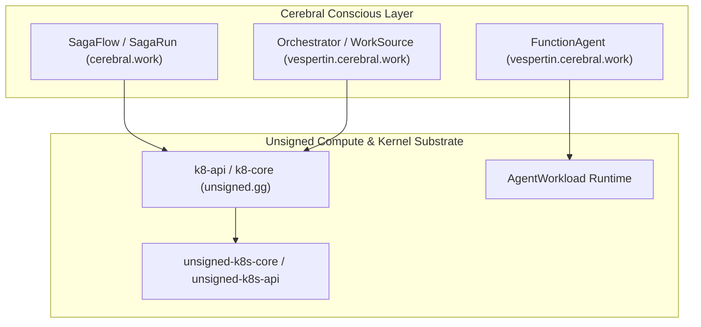

# Architecture Overview

This directory documents the Kubernetes architecture for Cerebral and Unsigned.
It defines the system boundary and the Rust type system.

## Documents

- [Substrate and Conscious Boundary](substrate-conscious-boundary.md)
  Explains the separation between Unsigned compute substrates and the Cerebral conscious layer.
- [Kubernetes Rust Type System](kubernetes-rust-type-system.md)
  Details `kube-rs`, `k8s-openapi`, schema derivation, and JSON merge patch rules.
- [CRD Catalog](crd-catalog.md)
  Catalogs all custom resource definitions across the estate.

## System Model



## Maintenance

Run the generator script to update these files:

```bash
python3 scripts/generate_k8s_docs.py
```

Verify documentation parity with tests:

```bash
python3 -m unittest discover -s tests -v
```
