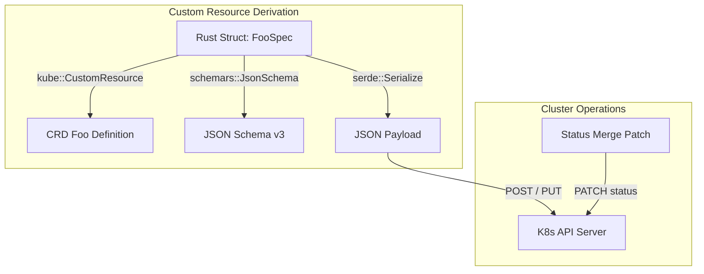

# Kubernetes Rust Type System

This guide explains how Kubernetes types work in Rust across the estate.
It describes design patterns, schema derivation, and patch semantics.

## The Dual-Plane Architecture

Rust operators in the estate interact with two distinct type layers:

1. **Upstream Schema Types** (`k8s-openapi`)
   Generated from standard Kubernetes OpenAPI specifications.
   These types represent standard resources such as `Pod`, `Service`, and `Node`.
2. **Custom Resource Types** (`kube::CustomResource`)
   Domain-specific custom resources generated via procedural derive macros.



## Derive Macro: `kube::CustomResource`

Custom resources use the `CustomResource` derive macro from `kube`.
This macro generates the top-level resource struct and Kubernetes metadata.

```rust
use kube::CustomResource;
use schemars::JsonSchema;
use serde::{Deserialize, Serialize};

#[derive(CustomResource, Serialize, Deserialize, Clone, Debug, JsonSchema)]
#[kube(
    group = "cerebral.work",
    version = "v1alpha1",
    kind = "SagaFlow",
    namespaced,
    status = "SagaFlowStatus"
)]
#[serde(rename_all = "camelCase")]
pub struct SagaFlowSpec {
    pub description: Option<String>,
}
```

### Key Attributes

- `group`: The API group name (for example, `cerebral.work`).
- `version`: The API version string (for example, `v1alpha1`).
- `kind`: The PascalCase resource kind.
- `namespaced`: Declares that the resource lives inside namespaces.
- `status`: Connects a separate status struct to the resource.

## Zero-I/O Domain Crates and Schema Derivation

Leaf domain crates (such as `k8-api` and `cerebral-k8s-domain`) enforce zero I/O.
They avoid network calls, file systems, and heavy runtimes.

### The `k8s-openapi` Schema Footprint

Upstream `k8s-openapi` structs do not implement `schemars::JsonSchema` by default.
Enabling the `schemars` feature in `k8s-openapi` inflates build times significantly.

To avoid this cost, our domain crates apply two patterns:

1. **Lightweight Wire Types**:
   Define dedicated structs with `#[derive(JsonSchema)]` matching Kubernetes wire formats.
2. **Feature Isolation**:
   Keep `schemars` dependencies on leaf API crates.
   Never pull heavy schema compilers into runtime kernels.

## JSON Merge Patch and Null Serialization

Kubernetes updates custom resource status using JSON merge patches.
A JSON merge patch deletes a field only when the key has an explicit `null` value.

### The Stale Status Bug (EST-138)

Using `#[serde(skip_serializing_if = "Option::is_none")]` on status fields causes defects.
When a failure condition clears, Rust sets the field to `None`.
If serialized without the key, Kubernetes retains the previous error message.

```rust
// Correct status struct pattern:
#[derive(Debug, Clone, Default, PartialEq, Serialize, Deserialize, JsonSchema)]
#[serde(rename_all = "camelCase")]
pub struct OrchestratorStatus {
    // None serializes as null on purpose to clear prior errors
    pub healthy: Option<String>,
    pub message: Option<String>,
    pub observed_generation: Option<i64>,
    #[serde(default)]
    pub conditions: Vec<Condition>,
}
```

WARNING: Never use `skip_serializing_if = "Option::is_none"` on nullable status fields.
The field will fail to delete during status recovery.

## Status Conditions and Wire Alignment

Status conditions must match the standard Kubernetes `metav1.Condition` wire format.

### Field Rules

- Use `camelCase` field serialization with `#[serde(rename_all = "camelCase")]`.
- Format timestamps using RFC3339 strings (`lastTransitionTime`).
- Use single uppercase words for condition reasons (`Reason`).
- Express status values as strings: `"True"`, `"False"`, or `"Unknown"`.

```rust
#[derive(Debug, Clone, PartialEq, Serialize, Deserialize, JsonSchema)]
#[serde(rename_all = "camelCase")]
pub struct Condition {
    pub type_: String,
    pub status: String,
    pub reason: String,
    pub message: Option<String>,
    pub last_transition_time: String,
    pub observed_generation: Option<i64>,
}
```

## Summary Checklist

1. Derive `CustomResource`, `Serialize`, `Deserialize`, and `JsonSchema`.
2. Apply `#[serde(rename_all = "camelCase")]` to specs and statuses.
3. Emit explicit `null` for `Option::None` in status merge patches.
4. Keep leaf domain crates free of network I/O and async runtimes.
