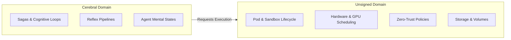

# Substrate and Conscious Boundary

This document defines the architectural boundary between Unsigned and Cerebral.

## Boundary Principles

The estate splits Kubernetes responsibilities into two distinct domains:

1. **Unsigned** owns compute, scheduling, and kernel primitives.
2. **Cerebral** owns cognitive loops, sagas, reflex targets, and deliberative states.

This separation prevents circular dependencies.
It also isolates conscious decision systems from hardware execution.

## Unsigned: Compute and Kernel Substrate

Unsigned components manage direct execution resources.
They do not make strategic or cognitive decisions.

### Crates and Locations

- **`unsigned-k8s-core`** (`projects/domain/schedule/k8s-core`)
  Foundational crate providing raw bindings.
  It re-exports `kube` 4.2.0 and `k8s-openapi` 0.28.0 with the `latest` feature.
- **`unsigned-k8s-api`** (`projects/domain/schedule/k8s-api`)
  Public API crate for Unsigned cluster services.
  Consumes `unsigned-k8s-core`.
- **`k8` Workspace** (`projects/domain/schedule/k8`)
  - **`k8-api`**: Zero-I/O leaf domain crate. Defines quantities, selectors, lifecycle conditions, and `AgentWorkload`.
  - **`k8-core`**: Core domain logic and scheduling models.
  - **`k8-orchestrator`**: Controller runtime and reconcile loops for hardware scheduling.
  - **`k8`**: Command-line interface for workload lifecycle.

### Responsibilities

- Container execution engines and pod sandboxes.
- GPU and CPU hardware placement.
- Slurm cluster integration and batch queues.
- Zero-trust network policy enforcement.
- Restricted pod security contexts (`restricted` profile).

## Cerebral: The Conscious Layer

Cerebral components manage cognition and multi-agent coordination.
They express intent through high-level custom resources.

### Crates and Locations

- **`cerebral-k8s-api`** (`projects/domain/schedule/cerebral-work-k8s-api`)
  Private crate for Cerebral Custom Resource Definitions (`cerebral.work/v1alpha1`).
  Defines `SagaFlow` and `SagaRun`.
- **`cerebral-k8s-domain`** (`projects/domain/schedule/cerebral-k8s/crates/cerebral-k8s-domain`)
  Zero-I/O algebraic state models and operator configurations.
- **`cerebral-k8s`** (`projects/domain/schedule/cerebral-k8s/crates/cerebral-k8s`)
  Systems operator runtime and crate re-exports.
- **`vespertin`** (`projects/platform/runtime/vespertin`)
  Conscious runtime operator.
  Manages `Orchestrator`, `WorkSource`, and `FunctionAgent` under `vespertin.cerebral.work/v1alpha1`.

### Responsibilities

- Multi-agent coordination and task delegation.
- Long-running cognitive workflows and sagas.
- Memory consolidation and observation capture.
- Source ingestion from trackers (for example, Linear).
- Agent execution sandboxing with Landlock.

## Dependency Invariant

Substrate crates never depend on conscious crates.
Conscious crates depend on substrate types or declare private schemas.
This rule protects the compute layer from cognitive state changes.
