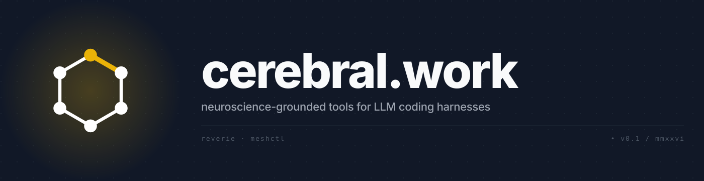

  

    

  

    <strong>Tools for coherent LLM coding agents.</strong> 
    Persistent memory and multi-agent orchestration, modeled on how biological minds actually work.
  

  

    <a href="https://cerebral.work">cerebral.work</a>
    &nbsp;·&nbsp;
    <a href="https://cerebral.work/reverie">reverie</a>
    &nbsp;·&nbsp;
    <a href="https://cerebral.work/meshctl">meshctl</a>
    &nbsp;·&nbsp;
    <a href="https://cerebral.work/docs">docs</a>
  

---

### reverie

A memory daemon modeled on human consolidation. Observation-layer writes, typed-then-distilled reads, sleep-phase consolidation between sessions. Ports 70 years of memory-consolidation research into the daily workflow of building software with AI.

### meshctl

Multi-agent orchestration with file-level locking and coord-protocol messaging. Runs many Claude Code / Cursor / Windsurf sessions in parallel without races. Replaces ad-hoc tmux hacks with a distributed-systems substrate.

### architecture

The estate separates conscious orchestration (`cerebral`) from execution substrates (`unsigned`).
Read the [Architecture Overview](https://github.com/cerebral-work/.github/blob/main/docs/architecture/README.md), [Substrate Boundary](https://github.com/cerebral-work/.github/blob/main/docs/architecture/substrate-conscious-boundary.md), and [Kubernetes Rust Type System](https://github.com/cerebral-work/.github/blob/main/docs/architecture/kubernetes-rust-type-system.md).

---

  
    LLM coding harnesses accumulate knowledge across sessions but lack a theory of where it should live.
    We&rsquo;re fixing that.
  

